# AniTimeNow



AniTimeNow is a modern, responsive anime streaming frontend. It offers anime browsing, search and filtering, detailed anime pages, episode navigation, HLS video playback with subtitle support, user authentication, and watch history tracking.

Built with React, TypeScript, Vite, and Tailwind CSS, the application is designed to work alongside an anime data API and the included Node.js/Express streaming proxy.

## ✨ Features

- **Responsive Design**: Fully responsive UI that works on desktop, tablet, and mobile devices
- **Anime Catalog**: Browse through a vast collection of anime titles
- **Video Streaming**: Stream anime episodes with HLS.js-powered video playback
- **User Authentication**: Create an account, log in, and manage your profile
- **Watch History**: Keep track of what you've watched and continue where you left off
- **Search Functionality**: Find your favorite anime quickly with powerful search
- **Filters & Sorting**: Filter anime by genre, status, and more
- **Episodes Management**: Navigate through seasons and episodes easily
- **Adaptive Video Quality**: Automatically adjusts video quality based on network conditions
- **Subtitle Support**: Watch anime with subtitles in various languages

## 🚀 Tech Stack

- **Frontend**: React 19, TypeScript
- **Build Tool**: Vite
- **Styling**: Tailwind CSS
- **Routing**: React Router
- **API Client**: Axios
- **Video Playback**: HLS.js with Plyr player styling
- **Streaming Proxy**: Node.js and Express (`server.js`)
- **Planned Backend**: Rust (not yet implemented; see [Roadmap](#-roadmap))

## 🛠️ Installation

1. Clone the repository:

   ```bash
   git clone https://github.com/vishwassharma38/AniTimeNow.git
   cd AniTimeNow
   ```

2. Install dependencies:

   ```bash
   npm install
   ```

3. Create your local environment file from the provided example:

   ```bash
   cp .env.example .env
   ```

   On Windows PowerShell:

   ```powershell
   Copy-Item .env.example .env
   ```

4. Start the development server and streaming proxy together:
   ```bash
   npm run start
   ```

## ⚙️ Environment Configuration

The repository includes `.env.example`, which documents the required variables. Copy it to a local `.env` file and adjust the values for your environment. The `.env` file is local-only and should not be committed.

| Variable              | Example                       | Purpose                                                 |
| --------------------- | ----------------------------- | ------------------------------------------------------- |
| `VITE_API_BASE_URL`   | `http://localhost:3000`       | Base URL of the anime data API consumed by the frontend |
| `VITE_PROXY_BASE_URL` | `http://localhost:3001/proxy` | Base URL of the Express video streaming proxy           |

These variable names are part of the existing frontend contract and must not be renamed.

## 📜 Available Scripts

| Script            | Description                                                           |
| ----------------- | --------------------------------------------------------------------- |
| `npm run dev`     | Starts the Vite development server                                    |
| `npm run build`   | Runs the TypeScript project compilation and the Vite production build |
| `npm run lint`    | Runs ESLint                                                           |
| `npm run preview` | Previews the production build                                         |
| `npm run proxy`   | Starts the Express streaming proxy                                    |
| `npm run start`   | Runs the Vite development server and Express proxy concurrently       |

## 🏗️ Architecture

AniTimeNow is a single-page React application backed by an anime data API and a local streaming proxy.

- **Frontend application**: React and TypeScript, built and served by Vite. Routes are defined in `src/App.tsx` and cover home, browse, categories, anime details, watch, login, register, and profile pages.
- **API communication**: All anime data requests are centralized in `src/services/api.ts`. An Axios instance uses `VITE_API_BASE_URL` as its base URL and exposes typed methods for top airing, most popular, recently added, search, genres, anime details, and video sources.
- **Video playback**: HLS streams are played with HLS.js. The player component routes m3u8 requests through the Express proxy using `VITE_PROXY_BASE_URL`, and also supports subtitles and adaptive quality.
- **Streaming proxy**: `server.js` is an Express server exposing `/proxy` and `/status`. The proxy forwards the `Referer` and other request headers, streams non-HLS responses directly, and rewrites relative segment URLs inside m3u8 playlists so that all segments are proxied correctly.

### Project Structure

```text
.
├── public/
│   └── logo.svg
├── src/
│   ├── components/
│   ├── pages/
│   ├── services/
│   │   └── api.ts
│   ├── types/
│   ├── App.tsx
│   └── main.tsx
├── .env.example
├── index.html
├── server.js
└── package.json
```

## 📋 Requirements

- Node.js 18 or newer (required by Vite 6 and Express 5)
- npm
- A modern web browser with JavaScript enabled
- An anime data API available at the URL configured in `VITE_API_BASE_URL`

## 📝 License

This project is licensed under the MIT License. The original MIT license and copyright notice are retained in the [LICENSE](LICENSE) file.

## 🙏 Credits

The frontend of AniTimeNow is adapted from Pixel Anime by ChocoMeow, The original repository is available at [https://github.com/ChocoMeow/Pixel-Anime](https://github.com/ChocoMeow/Pixel-Anime). The original MIT license and copyright notice are retained in [LICENSE](LICENSE).

Additional acknowledgements:

- [React](https://reactjs.org/)
- [TypeScript](https://www.typescriptlang.org/)
- [Vite](https://vitejs.dev/)
- [Tailwind CSS](https://tailwindcss.com/)
- [HLS.js](https://github.com/video-dev/hls.js/)
- [Plyr](https://plyr.io/)
- [React Router](https://reactrouter.com/)
- [Axios](https://axios-http.com/)
- [Express](https://expressjs.com/)

## 🗺️ Roadmap

- **Rust backend (planned)**: A Rust-based backend is planned for the long term. It is not part of the current codebase, and no Rust services are implemented in this repository yet.
